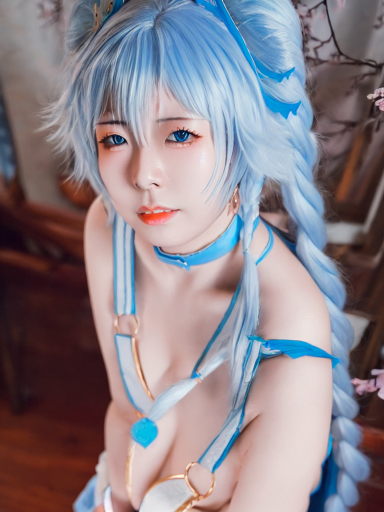
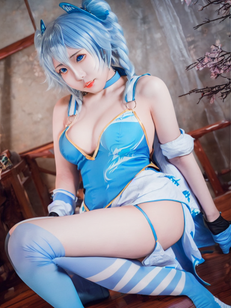

# 嗷呜虎虎 v5.1

## 基本信息
- 权重文件：`aowo_sd15_char_v5_1.safetensors`（52MB，dim 64 / alpha 32）
- sha256：`d49d9c8b8ff090248636ee723cf78b2c8475ff3dee090c2a5ed90e76f94fdc8f`
- 基座：SD1.5 `sd15-v1-5-pruned-emaonly.safetensors`
- 触发词：`ohw woman`
- 定位：目前主力。脸最像、出错率最低。

## 训练配置
- 数据集：`dataset_v53`，51 张（14 张脸图复制一份提高采样比例 + 身体图）
- 三种裁切比例：1:1 脸 / 3:4 胸像 / 2:3 全身
- 分辨率 832（分桶 704~1152）、batch 1、2600 步
- 优化器 AdamW8bit、lr 1e-4、min_snr γ=5、noise_offset 0.02
- 只训 UNet（`--network_train_unet_only`）+ `--full_fp16` + `--sdpa` + 梯度检查点 + 缓存 latent
- 显存峰值 2848MiB，训练约 30 分钟

## 推荐出图参数
- 尺寸 768×1024、LoRA 权重 0.85、steps 28、cfg 6.5、dpmpp_2m + karras
- 建议配 Canny 约束（见 `notes/自训LoRA生图流水线.md`）

## 已知问题
- 手部细节偶有粘连（白手套会连成一块）
- 衣服露得多，是素材本身的属性，压不住
- 全身图偶发身材比例拉长

## 样例

