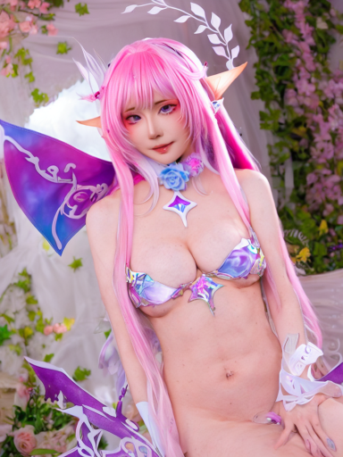
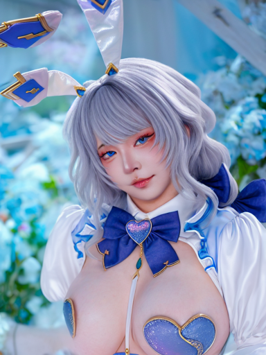
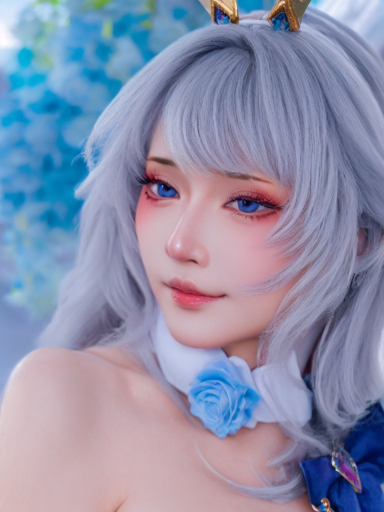

# 马吉 Machi v1

第二个人。两套 cos 素材（粉发精灵装 / 银蓝蝴蝶结装）一起训，同一个 LoRA。

## 基本信息
- 权重：`machi_v1.safetensors`（52M，dim 64 / alpha 32）
- sha256：`33bfd4e92d2456a3f2db19ab6a4e83cac9a3f7679062346d94c16aea945afbe5`
- 基座：SD1.5 `sd15-v1-5-pruned-emaonly.safetensors`
- 触发词：**`ohw2 woman`**（和嗷呜虎虎的 `ohw woman` 分开，两个模型可以同时装）
- 定位：目前这一版的唯一一版

## 训练配置
- 数据集：`dataset_m2`，714 张（119 + 145 张原图 × 三种裁切：1:1 脸 / 3:4 胸像 / 2:3 全身）
- 原图 8800×11000 以上，**先在原生分辨率上裁，再缩小到目标尺寸**（先缩后裁会让脸只剩百来像素，出来必糊）
- 分辨率 832（分桶 704~1152）、batch 1、6000 步
- 优化器 AdamW8bit、lr 1e-4、min_snr γ=5、noise_offset 0.02
- 只训 UNet + full_fp16 + sdpa + 梯度检查点 + 缓存 latent
- 显存峰值 2848MiB，训练约 55 分钟
- 脚本：`train_v1.sh`

## 两套衣服的写法

粉发精灵装：

    ohw2 woman, solo, one person, long pink hair, elf ears,
    purple and white fantasy cosplay, upper body, detailed skin, soft light

银蓝蝴蝶结装：

    ohw2 woman, solo, one person, silver grey hair,
    blue and white cosplay dress, blue bow, upper body, detailed skin, soft light

## 推荐出图参数
- 尺寸 768×1024、LoRA 权重 0.85、steps 28、cfg 6.5、dpmpp_2m + karras
- 30 张实测：全部单脸，零双头

## 已知问题
- 皮肤被磨得太平，像精修片，缺质感
- 手指偶尔并在一起
- 半身图露得多，是素材属性
- 中间档每 1000 步存一次，过拟合可退到 4000 或 5000

## 样例

