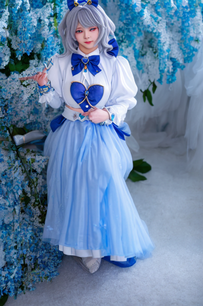
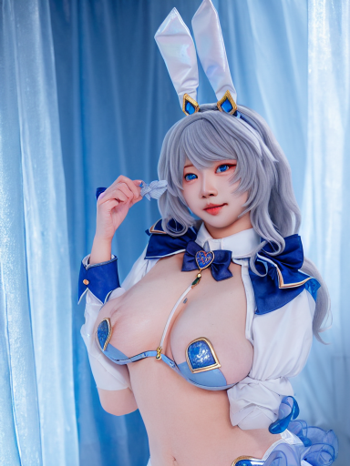

# 马吉 Machi v2

在 v1 基础上重做数据集的一版：不再"先缩后裁"，全部从原生分辨率裁切。

## 基本信息
- 权重：`machi_v2.safetensors`（52M，dim 64 / alpha 32）
- sha256：`ebca6c86727c1f6bef93d7e033d0e4bcc048ceee7a3f464125629791348939ef`
- 基座：SD1.5
- 触发词：**`ohw2 woman`**（与 v1 通用，两版不能同时装）
- 推荐权重：0.75（0.85 会显得塑料）

## 与 v1 的差别
| | v1 | v2 |
|---|---|---|
| 数据集 | 714 张，先缩到 1600 再裁 | 729 张，原生分辨率裁 |
| 构图 | 只有脸和局部 | 脸 1:1、胸像 3:4、全身 2:3 各一套 |
| 分辨率 | 832 | 896 |
| 步数 | 6000 | 3600 |

## 训练配置
- 优化器 AdamW8bit、lr 1e-4、min_snr γ=5、noise_offset 0.02
- 只训 UNet、full_fp16、sdpa、cache_latents
- 显存峰值 2.9G
- 脚本：`train_v2.sh`

## 实测差别
同种子同提示词对比：
- 上半身：手部完整、衣服结构正确；v1 手指粘连、领口错位
- 全身：v2 坐姿成立、裙摆完整、两条腿在；v1 下半身糊在一起、缺腿
- 质感：两版都偏精修，毛孔还是出不来，需要出图后放大

## 已知问题
- 皮肤仍偏平滑
- 全身像样本占比不足（243 张里只有三分之一），腿和脚偶尔还会飘

## 样例

