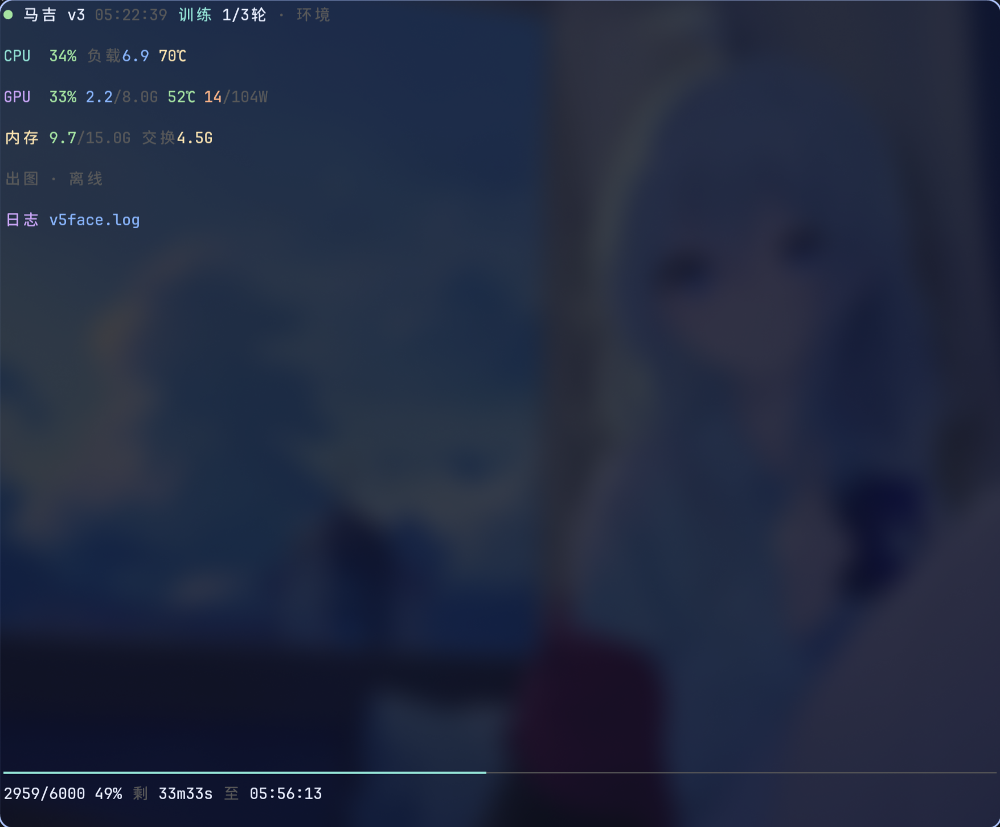

# train-status · 训练监视器（终端浮窗）



训 LoRA 的时候挂着看的一个小终端：六页信息，一秒到三秒刷新一次，浮在最上层不抢焦点。
在 Arch + niri + kitty 上写成并长期使用；别的组合大部分能用，窗口尺寸/跟随这两块依赖 niri 的 IPC。

## 六页

| 页 | 内容 |
| --- | --- |
| 环境 | CPU 占用/负载/温度、GPU 占用/显存/温度/功耗、内存与交换、出图服务是否在线、当前读哪份日志 |
| 流程 | 扫描 → 切图 → 打标 → 训练 → 出图 → 评分，六步的状态与耗时 |
| 质量 | loss 迷你曲线（按相对高度上色）+ 当前/最低/最高、学习率与调度、本版脚本的 分辨率/dim/batch、最新存档、评分结果 |
| 数据 | 素材套数、裁片总数与四类分布、标注条数、体积、基线 |
| 日志 | 最新训练日志里的关键行（ERROR 红 / WARNING 黄 / saving 绿） |
| 图片 | 素材缩略图（kitty 图形协议），滚轮或 w/s 翻图，左键或 i 用 imv 打开原图 |

## 按键

```
e / q   下一页 / 上一页          （浮窗里 q 不退出，退出用 Ctrl-C）
z / Z   缩小 / 放大一档          （四档，按屏幕逻辑宽度算，换屏幕自动跟随）
p       暂停刷新
c       环境页切换「占用 Top3」
w / s   图片页翻上一张 / 下一张
滚轮    图片页翻图
左键    图片页用 imv 打开当前这张原图
```

## 依赖

- Python 3.9+；`pynvml`（没有就只是不显示 GPU）、`Pillow`（图片页）
- `niri`（窗口几何、尺寸、把 imv 带到同一张）
- `kitty`（图形协议显示缩略图）
- `imv` + `imv-msg`（看原图、与面板同步位置）

## 文件

| 文件 | 作用 |
| --- | --- |
| `train-status.py` | 主程序，六页渲染 + 按键 + 图片页 |
| `train-status.sh` | 薄壳：`loop` 常驻刷新，不带参数只打印一帧 |
| `train-status-popup.sh` | 在 kitty 里开浮窗，四档尺寸按屏幕逻辑宽度换算列/行 |
| `photo-view.sh` | 建一份与清单同序的符号链接目录，起 imv 并用 `imv-msg goto` 跳到指定那张 |

## 跟训练脚本的约定

- 进度从 `/tmp/*.log` 里最近一小时写过、且含 `steps:` / `it/s` / `avr_loss` 的那份读
- 步数每轮会重置，翻轮靠「步数回退」判定，记在 `.epoch_cur`
- 日志被 Python 缓冲（没加 `-u`）时步数会滞后，这时用最新 `*-step*.safetensors` 的步数兜底
- 想要完全实时：训练脚本里用 `python -u`，或设 `PYTHONUNBUFFERED=1`

## 已知限制

- 图片页显示的是缩略图（最长边约 2600px，缓存在 `~/.dsh/miyu/cache/thumbs`），原图走 imv
- 跟随 imv 位置靠读窗口标题（`imv - [3/1414] ...`），换了别的看图软件就不生效
- 窗口尺寸档、跟随移动只对 niri 有效；其他合成器下 `z/Z` 会静默无效
